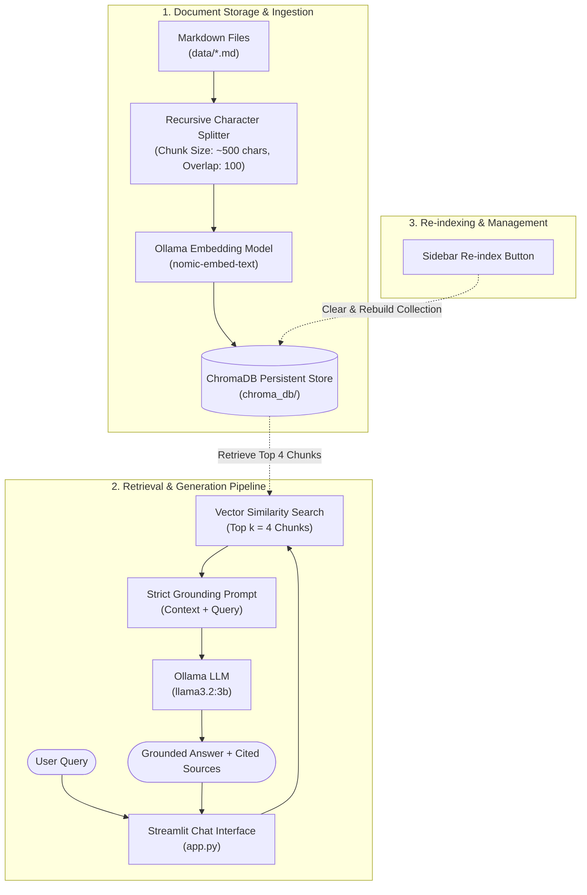

# 📈 ZenithTick RAG - Trading Platform Incident & Runbook Assistant

An offline, privacy-first Retrieval-Augmented Generation (RAG) assistant built with **Streamlit**, **LangChain**, **ChromaDB**, and **Ollama**. The system provides real-time question-answering across trading operations runbooks and past incident post-mortems with strict context grounding and source citations.

> [!NOTE]
> **Synthetic Data Disclaimer:** All documents, incident reports, runbooks, logs, system architectures, network topology, and metrics contained in the `data/` directory are **100% fictional and synthetic**. They were generated solely for educational, testing, and demonstration purposes. No real company names, proprietary exchange protocols, or production infrastructures are represented.

---

## 🎯 Problem Statement

Operational teams (SRE, Low-Latency Network Engineers, Data Engineers, and Quant Support) managing high-throughput trading data platforms face severe time pressure during live market outages. Diagnosing issues like database pool starvation, multicast packet loss, PTP clock desynchronization, and queue backlogs requires fast access to institutional knowledge spread across post-mortems and runbooks.

Traditional keyword search often surfaces outdated tickets or misses semantic intent. This application indexes operational runbooks and past incident reports into a persistent local vector database and uses a local Large Language Model to:
- Retrieve relevant operational procedures and root causes within milliseconds.
- Restrict responses **strictly** to the retrieved context, preventing LLM hallucinations.
- Automatically cite the exact source markdown files under every answer.
- Support one-click document re-indexing directly from the user interface.

---

## 🏗️ Architecture



---

## ⚙️ Setup Instructions

### 1. Prerequisites
- **Python:** 3.10 or higher
- **Ollama:** Installed and running locally ([https://ollama.com](https://ollama.com))

### 2. Pull Ollama Models
Ensure both the embedding model and the generation model are pulled into Ollama:
```bash
ollama pull nomic-embed-text
ollama pull llama3.2:3b
```

### 3. Install Python Dependencies
Activate your virtual environment and install the required packages:
```powershell
pip install -r requirements.txt
```

### 4. Run the Streamlit Application
Start the Streamlit web interface:
```powershell
streamlit run app.py
```
*(If running within the project virtual environment on Windows, use `.\venv\Scripts\streamlit.exe run app.py`)*

On first launch, the application will automatically read and index all documents from `data/` into `chroma_db/`.

---

## 💡 Example Questions

| Question | Target File(s) | Expected Behavior |
| :--- | :--- | :--- |
| **"What caused the database connection timeouts on January 14?"** | `INC-2026-0114-database-connection-timeouts.md` | Explains the unindexed compliance audit query and hypertable lock contention. |
| **"What are the diagnosis steps for database connection timeouts in the runbook?"** | `RUNBOOK-database-connection-timeouts.md` | Details PgBouncer inspection commands and `pg_stat_activity` SQL queries. |
| **"What was the root cause of the expired certificate incident?"** | `INC-2026-0322-expired-tls-certificate.md` | Identifies the intermediate CA expiration and unmerged Terraform promotion PR. |
| **"What are the symptoms of high CPU on the feed handler?"** | `INC-2026-0219-high-cpu-feed-handler.md`<br/>`RUNBOOK-feed-handler-performance.md` | Lists multicast sequence gaps, packet drops, and 100% core saturation. |
| **"Why did the nightly batch job fail on March 5?"** | `INC-2026-0305-failed-nightly-batch-job.md` | Explains volume skew on retail option quotes and Spark broadcast join OOM. |
| **"What is the capital of Australia?"** *(Negative / Out-of-Domain Test)* | None | Strictly responds: *"The provided context does not contain enough information to answer this question."* |

---

## ⚠️ Limitations & Considerations

1. **Local Ollama Dependency:**
   The application requires the Ollama daemon to be reachable at `http://localhost:11434`. If Ollama is stopped or the models are not pulled, queries will fail.
2. **Chunk Size vs. Context Window:**
   Documents are split into ~500-character chunks with a 100-character overlap. While this ensures tight semantic matching, information spanning large multi-page tables may require adjusting `CHUNK_SIZE` or `TOP_K`.
3. **Retrieval Depth (Top-K = 4):**
   The application retrieves the top 4 chunks per question to fit within low-latency bounds for small 3B models. Complex cross-incident trend inquiries may require higher `TOP_K` values.
4. **Strict Grounding:**
   The model is strictly instructed not to use outside knowledge. If a question uses terminology not present in the indexed runbooks or incident reports, it will declare that the context lacks sufficient information rather than attempting to guess.


